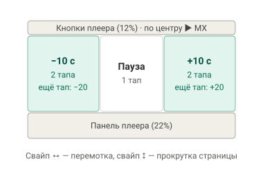
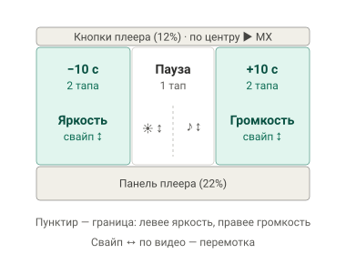

# Видеоплееры: громкость 100% и перемотка двойным тапом

**[⬇ Установить](https://raw.githubusercontent.com/Rolarn/Tamper-scripts/main/scripts/video-player-tweaks/video-player-tweaks.user.js)** · [История изменений](CHANGELOG.md)

Жесты и громкость для видео на любых сайтах, в первую очередь для телефона.

## Зоны касания

Обычный плеер на странице (плюс горизонтальный свайп по видео — перемотка):

Полноэкранный режим — те же тапы и перемотка свайпом плюс свайпы яркости и громкости:

## Перемотка двойным тапом

Как в приложении YouTube:

- **двойной тап по правой трети видео** — вперёд на 10 секунд, **по левой** — назад;
- **каждый следующий тап** в той же стороне, пока не прошла ~1 с, добавляет ещё 10 секунд: 10 → 20 → 30…;
- поверх видео показывается подсказка, например `« 30 с`;
- центр видео, верхняя полоса и нижняя панель управления работают как обычно — там остаются кнопки плеера;
- одиночный тап доходит до плеера как обычно (пауза/пуск); если он оказался первым в двойном тапе, скрипт возвращает воспроизведение как было — в том числе у плееров, которые ставят паузу с задержкой;
- двойной тап не включает полный экран и не увеличивает страницу.

Работает с любым плеером на обычном HTML5 `<video>`, в том числе во встроенных фреймах и в полноэкранном режиме. На YouTube отключено — там своя такая же функция.

## Перемотка свайпом

Как в MX Player, в обычном и полноэкранном режиме:

- **свайп влево или вправо по видео** — перемотка назад или вперёд; не нужно целиться в тонкую полосу прокрутки плеера;
- свайп на всю ширину видео — 2 минуты (настройка `SCRUB_FULL_WIDTH_SEC`), короткий свайп — несколько секунд;
- во время свайпа видно, куда перемотается: `+1:25 · 12:40 / 13:46`; перемотка происходит, когда отпускаете палец — одна загрузка вместо десятков, быстрее и бережнее к сети;
- свайп по нижней панели плеера остаётся плееру, косые свайпы не перехватываются.

## Открыть в MX Player

- Коснитесь видео — вверху по центру на 10 секунд появится маленькая кнопка **▶ MX**.
- Тап по ней ставит видео в браузере на паузу и открывает его в MX Player **с того же места**, с названием страницы вместо имени файла.
- Firefox спросит «Открыть в другом приложении?» — подтвердите. Чтобы не спрашивал, в настройках Firefox выберите *Открывать ссылки в приложениях → Всегда*.
- По умолчанию открывается бесплатная версия (`com.mxtech.videoplayer.ad`); для Pro поменяйте `MX_PACKAGE`.

Если сайт собирает видео в браузере из кусков (адрес `blob:`), скрипт ищет замену:
1. ссылку на скачивание на странице с указанием качества (`…-720p.mp4`, `/dload/…`) — берётся самое высокое качество, но не выше `MX_MAX_HEIGHT` (1080p);
2. адрес потока `.m3u8` среди файлов, которые загрузила страница.

Когда кнопки нет или MX не откроет видео:
- замены не нашлось (например, YouTube) — кнопка не показывается;
- сайт отдаёт видео только со своими cookies или заголовками — MX их не получит и покажет ошибку.

## Без автозапуска и со звуком (reactor.cc)

На сайтах из списка `CLICK_TO_PLAY_SITES` (по умолчанию reactor.cc и joyreactor, включая поддомены):

- видео **не запускаются сами** — ни по атрибуту `autoplay`, ни скриптом сайта при прокрутке;
- по центру остановленного видео — **большая кнопка ▶**: тап запускает видео со звуком. После первого запуска пауза и пуск у этого видео работают как обычно, в том числе маленькими кнопками встроенного плеера;
- видео **со звуком**: атрибут `muted` снимается, а если сайт снова выключает звук сам, скрипт включает его обратно; выключение звука вами кнопкой плеера сохраняется;
- заранее загружается только начало видео — меньше трафика, страница с десятком роликов не тормозит.

Ролики YouTube и других сайтов, встроенные в комментарии, — это чужие плееры в отдельных фреймах; на них это правило не распространяется.

Если нужно то же самое для всех сайтов сразу — в Firefox есть встроенная настройка: *Настройки → Разрешения сайтов → Автовоспроизведение → Блокировать аудио и видео*.

## Яркость и громкость свайпами

Как в MX Player, в полноэкранном режиме:

- **вертикальный свайп по левой половине видео** — яркость: вверх ярче, вниз темнее (от 10% до 150%);
- **по правой половине** — громкость: вверх громче, вниз тише (от 0 до 100%);
- во время свайпа поверх видео показывается текущее значение;
- горизонтальные и косые свайпы не перехватываются — их получает плеер сайта.

Чем это отличается от MX Player: веб-страница не может менять **яркость экрана** и **системную громкость** — браузер этого не позволяет. Поэтому яркость меняется у самого видео (фильтром), а громкость — у плеера, в пределах текущей громкости телефона. Если на 100% тихо, прибавьте звук кнопками телефона.

Вне полноэкранного режима свайпы выключены: там вертикальный свайп прокручивает страницу. Включить их везде можно настройкой `SWIPE_FULLSCREEN_ONLY = false`, но тогда свайп по видео перестанет прокручивать страницу.

## Громкость 100%

Некоторые сайты запускают видео на пониженной громкости, а в мобильной версии ползунка нет. Скрипт не даёт сайтам занижать громкость:

1. **Плееры KVS (`kt_player`)** хранят громкость в `localStorage.volume` и по ней рисуют иконку. Скрипт поднимает это значение до `1` до запуска плеера (при первом заходе — записывает заранее).
2. **Остальные плееры**: любая громкость выше нуля превращается в 100%.
3. **Запасной способ**: громкость поднимается при старте воспроизведения, с ограничением числа правок.

Выключение звука работает как обычно. Громкость, выставленную свайпом, скрипт не перебивает.

## Настройки

В начале файла, блок `НАСТРОЙКИ / SETTINGS`:

| Параметр | По умолчанию | Что значит |
|---|---|---|
| `EXCLUDE` | `[]` | Сайты, где скрипт не работает вовсе |
| `VOLUME_ENABLED` | `true` | Громкость 100% |
| `SEEK_ENABLED` | `true` | Перемотка двойным тапом |
| `SEEK_STEP` | `10` | Шаг перемотки, секунд |
| `SEEK_EXCLUDE` | `['youtube.com']` | Сайты со своей перемоткой |
| `SEEK_FULLSCREEN_ONLY` | `false` | Перемотка только в полноэкранном режиме |
| `SWIPE_ENABLED` | `true` | Свайпы яркости и громкости |
| `SWIPE_FULLSCREEN_ONLY` | `true` | Свайпы только в полноэкранном режиме |
| `SWIPE_SENSITIVITY` | `0.8` | Какую долю высоты видео провести для изменения на 100% |
| `BRIGHTNESS_MIN`, `BRIGHTNESS_MAX` | `0.1`, `1.5` | Пределы яркости |
| `SCRUB_ENABLED` | `true` | Перемотка горизонтальным свайпом |
| `SCRUB_FULLSCREEN_ONLY` | `false` | Перемотка свайпом только в полноэкранном режиме |
| `SCRUB_FULL_WIDTH_SEC` | `120` | Сколько секунд даёт свайп на всю ширину видео |
| `MX_ENABLED` | `true` | Кнопка «▶ MX» |
| `MX_PACKAGE` | `com.mxtech.videoplayer.ad` | Какой MX Player открывать (`.pro` — Pro) |
| `MX_BUTTON_MS` | `10000` | Сколько кнопка видна после касания, мс |
| `MX_MAX_HEIGHT` | `1080` | Предел качества ссылки на скачивание для видео `blob:` |
| `CLICK_TO_PLAY_SITES` | `['reactor.cc', 'joyreactor.cc', 'joyreactor.com']` | Сайты без автозапуска и со звуком |
| `GESTURE_WINDOW_MS` | `1000` | Сколько мс после вашего тапа запуск видео считается вашим |
| `BIG_PLAY_BUTTON` | `true` | Большая кнопка ▶ на остановленных видео |

> Настройки внутри файла перезапишутся при обновлении скрипта.

## Совет: больше буфера в Firefox

Скрипт не может управлять буфером: сколько видео загружать заранее, решает браузер. В Firefox для Android (Fennec, Beta, Nightly) это настраивается в `about:config`:

| Настройка | По умолчанию | Например |
|---|---|---|
| `media.cache_readahead_limit` | `60` | `600` — сколько секунд видео загружать вперёд |
| `media.cache_resume_threshold` | `30` | `300` — с какого запаса возобновлять загрузку |

Работает для видео, которые отдаются одним файлом (как в плеерах KVS). Сайты с потоковой загрузкой кусками (HLS/DASH, например YouTube) управляют буфером сами — там эти настройки не действуют. Больший буфер расходует больше трафика и памяти.

## Ограничения

- Если плеер сайта сам использует двойной тап (например, свою перемотку), добавьте сайт в `SEEK_EXCLUDE` или включите `SEEK_FULLSCREEN_ONLY`. Если мешает перемотка свайпом — `SCRUB_ENABLED = false` или `SCRUB_FULLSCREEN_ONLY = true`.
- Плееры, рисующие видео не через `<video>` (canvas, Flash) и плееры внутри закрытого Shadow DOM, перемотку не получат.
- Громкость выше 100% скрипт не делает: если запись тихая, усиления нет.
- Яркость и громкость свайпом не меняют яркость экрана и системную громкость — только у видео.

---

### English

- **Double-tap seek**, YouTube-style: double-tap the right third of any HTML5 video to skip 10 s forward, the left third to go back; every further tap adds 10 s. Centre, top strip and bottom control bar are left to the player. Disabled on YouTube, which has its own.
- **Swipe seek**, MX Player-style, inline and in fullscreen: swipe left/right over the video to seek (full width = 2 min); the seek happens on release.
- **Open in MX Player**: touch a video to show a small "▶ MX" button for 10 s; it pauses the video and opens it in MX Player at the same position (for `blob:` videos it falls back to a download link on the page or a loaded `.m3u8` stream).
- **No autoplay, sound on** for `CLICK_TO_PLAY_SITES` (reactor.cc by default): videos start only on your tap/click/key or the big ▶ button shown over paused videos, the `muted` attribute is removed and site-initiated muting is undone.
- **Brightness/volume swipes**, MX Player-style, in fullscreen: left half = brightness (a filter on the video, 10–150%), right half = player volume (0–100% of the system volume). Web pages cannot change screen brightness or system volume.
- **Volume 100%**: raises the stored volume of KVS (`kt_player`) players and turns any non-zero volume of other players into 100%. Muting still works.

Settings are at the top of the file.
